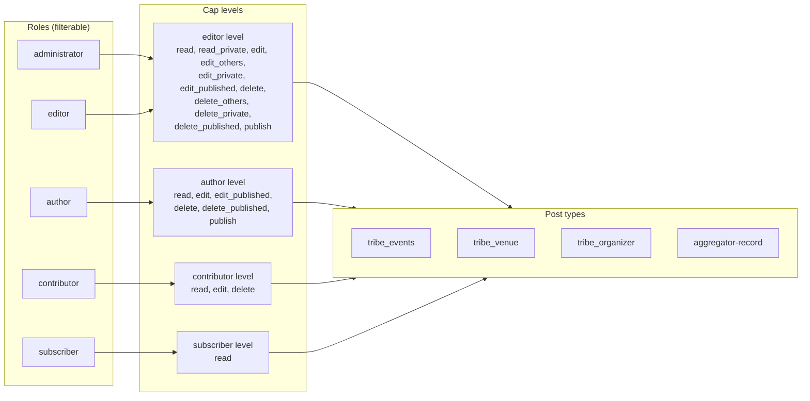
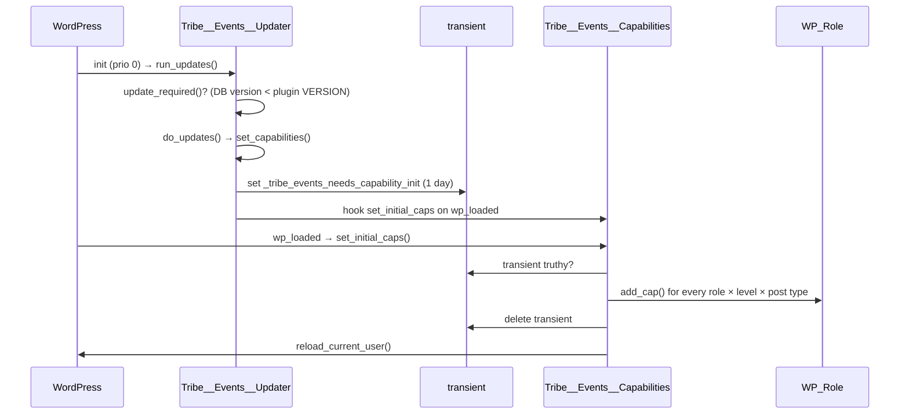
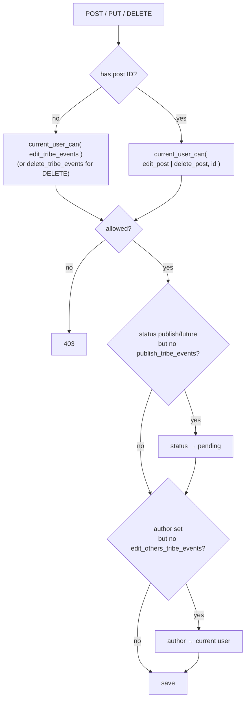
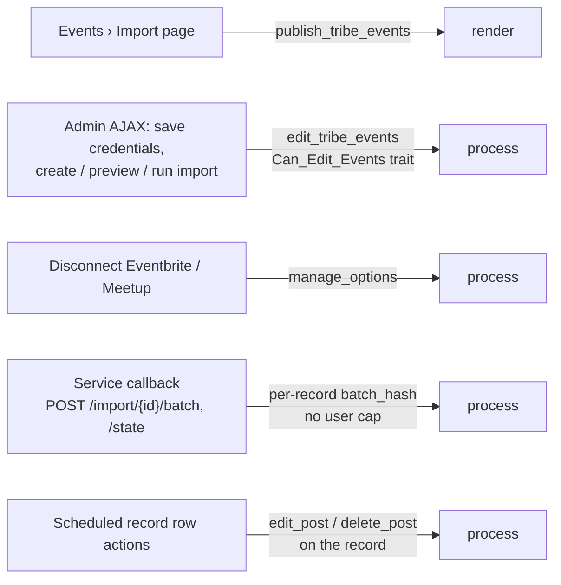

# RBAC in The Events Calendar

> **TL;DR**
>
> - TEC is the **only plugin in the suite that creates capabilities**. It adds `*_tribe_events`, `*_tribe_venues`, `*_tribe_organizers` and `*_aggregator-records` caps to the five core WordPress roles.
> - Each role gets a **level**: `editor`, `author`, `contributor` or `subscriber`. **Administrators get the `editor` level**, not something bigger.
> - Caps are granted **once per version change**, on `wp_loaded`, behind a transient. Deactivation removes them again.
> - The REST API (`tribe/events/v1`) is **public to read** and maps writes onto the same caps.
> - You change who can do what with **filters** or by editing role caps with a role plugin. See [How to change it](#how-to-change-it).

Suite overview lives in `tribe-common/docs/RBAC`.

---

## How to read this page

- **Support / QA**: read [Who can do what](#who-can-do-what) and [Gotchas](#gotchas). Stop there.
- **Engineers**: continue to [How it works](#how-it-works), [Where it lives in code](#where-it-lives-in-code) and [How to change it](#how-to-change-it).
- Each section stands on its own. Skipping is fine.

---

## Who can do what

Default WordPress roles, nothing customised. ✅ = can, **own** = only posts they wrote, ❌ = cannot.

| Feature | Capability checked | Admin | Editor | Author | Contributor | Subscriber | Logged-out |
|---|---|---|---|---|---|---|---|
| See the Events admin menu | `edit_tribe_events` | ✅ | ✅ | ✅ | ✅ | ❌ | ❌ |
| Create an event (draft) | `edit_tribe_events` | ✅ | ✅ | ✅ | ✅ | ❌ | ❌ |
| Publish an event | `publish_tribe_events` | ✅ | ✅ | ✅ | ❌ | ❌ | ❌ |
| Edit someone else's event | `edit_others_tribe_events` | ✅ | ✅ | ❌ | ❌ | ❌ | ❌ |
| Edit a published event | `edit_published_tribe_events` | ✅ | ✅ | own | ❌ | ❌ | ❌ |
| See private events | `read_private_tribe_events` | ✅ | ✅ | ❌ | ❌ | ❌ | ❌ |
| Delete an event | `delete_tribe_events` (+ `others`/`published` variants) | ✅ | ✅ | own | own drafts | ❌ | ❌ |
| Create / edit venues & organizers | `edit_tribe_venues`, `edit_tribe_organizers` | ✅ | ✅ | ✅ | ✅ | ❌ | ❌ |
| Pick an existing venue / organizer in the event editor | none | ✅ | ✅ | ✅ | ✅ | ❌ | ❌ |
| Create a new venue / organizer inline in the event editor | `create_posts` of the linked type | ✅ | ✅ | ✅ | ✅ | ❌ | ❌ |
| Manage event categories | `publish_tribe_events` | ✅ | ✅ | ✅ | ❌ | ❌ | ❌ |
| Assign event categories | `edit_tribe_events` | ✅ | ✅ | ✅ | ✅ | ❌ | ❌ |
| Event Aggregator import page | `publish_tribe_events` | ✅ | ✅ | ✅ | ❌ | ❌ | ❌ |
| Save Aggregator credentials, run an import | `edit_tribe_events` | ✅ | ✅ | ✅ | ✅ | ❌ | ❌ |
| Disconnect Eventbrite / Meetup | `manage_options` | ✅ | ❌ | ❌ | ❌ | ❌ | ❌ |
| Events › Settings | `manage_options` (via common) | ✅ | ❌ | ❌ | ❌ | ❌ | ❌ |
| Calendar Embeds admin page | `edit_published_tribe_events` | ✅ | ✅ | ✅ | ❌ | ❌ | ❌ |
| Customizer sections | `edit_theme_options` | ✅ | ❌ | ❌ | ❌ | ❌ | ❌ |
| Category colours (save a colour on a term) | `edit_term` | ✅ | ✅ | ✅ | ❌ | ❌ | ❌ |
| Migrations (CT1, category colours), duplicate-merge tool | `manage_options` | ✅ | ❌ | ❌ | ❌ | ❌ | ❌ |
| REST: read published events, venues, organizers | none | ✅ | ✅ | ✅ | ✅ | ✅ | ✅ |
| REST: read drafts / private | `read_post` / `edit_tribe_events` | ✅ | ✅ | own | own | ❌ | ❌ |
| REST: create / edit / delete | `edit_tribe_events`, `edit_post`, `delete_post` | ✅ | ✅ | own | own drafts | ❌ | ❌ |
| Calendar views on the front end | none | ✅ | ✅ | ✅ | ✅ | ✅ | ✅ |

**Why Admin and Editor match:** both get the `editor` cap level. Everything an administrator can do beyond an editor comes from core caps like `manage_options`, not from TEC.

> ⚠️ Author and Contributor have `edit_tribe_events` too. The Events menu shows for them. That is intended: they see and manage their own events.

---

## How it works

### 1. Roles → levels → caps

`Tribe__Events__Capabilities` holds a list of roles and a list of cap levels. On bootstrap it walks every role, picks a level, and calls `add_cap()` for each cap in that level, for each of the four post types.

The cap *names* come from each post type's `capability_type`. The level lists are property names on `$post_type_object->cap`, so `edit_posts` becomes `edit_tribe_events` for events and `edit_tribe_venues` for venues.

| Post type | `capability_type` | Example caps |
|---|---|---|
| `tribe_events` | `tribe_event` / `tribe_events` | `edit_tribe_events`, `publish_tribe_events`, `read_private_tribe_events` |
| `tribe_venue` | `tribe_venue` / `tribe_venues` | `edit_tribe_venues`, `delete_tribe_venues` |
| `tribe_organizer` | `tribe_organizer` / `tribe_organizers` | `edit_tribe_organizers` |
| Aggregator record | `aggregator-record` / `aggregator-records` | `edit_aggregator-records` |
| Calendar Embeds | `post` | `edit_posts`, `publish_posts` (core caps) |

All four custom types set `map_meta_cap => true`, so `edit_post` with an event ID resolves to the right `edit_*_tribe_events` primitive automatically.

### 2. When caps get written

Caps are not written on activation. They are written on the **first page load after a version change**, and again only when the version changes.

- `Capabilities::hook()` also attaches `set_initial_caps` to `wp_loaded` on every load, but the method returns early unless the transient is set. Cost on a normal request: one transient read.
- **Deactivation** calls `remove_all_caps()`, which strips from every role any cap whose name *contains* a TEC post type slug.
- The DB version is stored by the updater, so re-activating after a deactivation re-runs the whole thing.

### 3. REST writes (`tribe/events/v1`)

Reads need no permission callback. Writes check a cap in `can_create()`, `can_edit()`, `can_delete()`, then **scale the request back** instead of rejecting it.

Venues and organizers follow the same shape with their own caps. Categories and tags need `edit_tribe_events` **and** the taxonomy's `manage_terms` (which is `publish_tribe_events` for event categories).

### 4. Event Aggregator

Three different caps guard three different layers.

The service callbacks run as nobody. They authenticate with a hash stored on the import record, so a user cap would be meaningless there. Imported events are attributed to the record's author if that user can `edit_tribe_events`, else to the current user, else to the first user who can.

### 5. Smaller pieces

- **Linked posts** (venue/organizer inside the event editor): the "create new" UI appears only if the user has the linked type's `create_posts` and the type allows creation. Auto-publishing a linked post when the event publishes requires a **logged-in user** plus `publish_post` on it, so imports and CLI never auto-publish.
- **Block editor**: event meta is registered with an `auth_callback` that checks `edit_post` on the event. Event-status meta checks the core `edit_posts` instead.
- **Category colours**: saving a colour needs `edit_term` on that term; starting the migration needs `manage_options`.
- **`show_in_rest`**: decided at construct time with `current_user_can( 'manage_options' )`. The block-editor REST surface for events, venues and organizers is therefore admin-only, and venues/organizers only when ECP is active.

---

## Where it lives in code

Paths are relative to `src/`. Search for the method name; line numbers move.

| Area | File | What to look for |
|---|---|---|
| Roles, levels, grant / remove | `Tribe/Capabilities.php` | `$roles`, `$cap_aliases`, `set_initial_caps()`, `register_post_type_caps()`, `remove_all_caps()` |
| Bootstrap trigger | `Tribe/Updater.php` | `set_capabilities()`, `get_constant_update_callbacks()` |
| Deactivation cleanup | `Tribe/Deactivation.php` | `clear_capabilities()` |
| Event post type args | `Tribe/Main.php` | `register_post_type()`, `$postTypeArgs`, `capability_type` |
| Venue / organizer args | `Tribe/Venue.php`, `Tribe/Organizer.php` | `$post_type_args`, `capability_type` |
| Aggregator record type | `Tribe/Aggregator/Records.php` | `capability_type`, `get_post_type_args()` |
| Calendar Embeds type | `Events/Calendar_Embeds/Calendar_Embeds.php` | `capability_type => 'post'` |
| Calendar Embeds menu | `Events/Calendar_Embeds/Admin/List_Page.php` | `edit_published_tribe_events` |
| Event category taxonomy caps | `Tribe/Main.php` | `register_taxonomy()`, `capabilities` |
| Admin menus (venues, organizers) | `Tribe/Main.php` | `add_submenu_page()`, `edit_tribe_venues` |
| Admin bar | `Tribe/Admin/Bar/Default_Configurator.php` | `edit_tribe_events`, `publish_tribe_events`, `manage_options` |
| Settings / Help / Troubleshooting pages | `Tribe/Admin/Settings.php` | capability keys (defaults come from common) |
| Aggregator page | `Tribe/Aggregator/Page.php` | `cap->publish_posts` |
| Aggregator AJAX gate | `Events/Traits/Can_Edit_Events.php` | `current_user_can_edit_events()` |
| Aggregator tabs | `Tribe/Aggregator/Tabs/New.php`, `Edit.php`, `Scheduled.php` | the trait call, `cap->delete_post` |
| Aggregator service REST | `Tribe/Aggregator/REST/V1/Endpoints/Base.php`, `Batch.php`, `State.php` | `batch_hash`, `can_create()` |
| Aggregator disconnect | `Tribe/Aggregator/Settings.php` | `manage_options` |
| REST v1 writes | `Tribe/REST/V1/Endpoints/Single_Event.php`, `Single_Venue.php`, `Single_Organizer.php` | `can_create()`, `can_edit()`, `can_delete()` |
| REST v1 scale-back | `Tribe/REST/V1/Endpoints/Base.php` | `scale_back_post_status()`, `scale_back_author()` |
| REST v1 readable statuses | `Tribe/REST/V1/Endpoints/Archive_Base.php` | `get_readable_post_stati()`, `can_read_others_posts()` |
| REST v1 terms | `Tribe/REST/V1/Endpoints/Term_Single_Base.php` | `can_create()` |
| REST v1 on/off | `Tribe/REST/V1/System.php` | `tribe_events_rest_api_enabled` |
| Views V2 HTML endpoint | `Views/V2/Rest_Endpoint.php` | `is_valid_request()` (nonce, no cap) |
| Linked posts | `Tribe/Linked_Posts.php` | `cap->create_posts`, `tribe_events_linked_posts_dropdown_enable_creation` |
| Linked post auto-publish | `Tribe/Main.php` | `publish_post` meta cap, `is_user_logged_in()` |
| Classic meta save | `Tribe/Meta/Context.php`, `Tribe/Meta/Save.php` | `current_user_can_edit_events()` |
| Block editor meta | `Tribe/Editor/Meta.php` | `auth_callback` (inherited from common) |
| Event status meta | `Events/Event_Status/Classic_Editor.php` | `edit_posts` |
| Category colours | `Events/Category_Colors/Admin/Abstract_Admin.php` | `edit_term` |
| Onboarding wizard REST | `Events/Admin/Onboarding/API.php` | `tec_events_onboarding_wizard_permissions` |
| CT1 migration AJAX | `Events/Custom_Tables/V1/Migration/Ajax.php` | `manage_options` |

---

## How to change it

Prefer a filter. For per-site role tweaks, use a role-editor plugin on the `*_tribe_events` caps; TEC only writes them once per version.

| Filter | Default | Changes |
|---|---|---|
| `tribe_events_filter_roles_with_capabilities` | `administrator, editor, author, contributor, subscriber` | Which roles receive TEC caps on bootstrap |
| `tribe_events_register_event_type_args` | event post type args | `capability_type`, `map_meta_cap`, `show_in_rest` for events |
| `tribe_events_register_venue_type_args` | venue post type args | Same, for venues |
| `tribe_events_register_organizer_type_args` | organizer post type args | Same, for organizers |
| `tribe_events_register_event_cat_type_args` | taxonomy args | `capabilities` for event categories |
| `tec_events_calendar_embeds_post_type_args` | embeds post type args | Caps for Calendar Embeds |
| `tribe_events_linked_posts_dropdown_enable_creation` | `create_posts` && `allow_creation` | Inline "create new venue/organizer" UI |
| `tribe_events_rest_api_enabled` | `true` | Turns the whole `tribe/events/v1` API off |
| `tribe_aggregator_batch_data_processing_enabled` | `true` | Whether the service may POST batches |
| `tribe_aggregator_remote_status_enabled` | `true` | Whether the service may POST status |
| `tec_events_onboarding_wizard_permissions` | `manage_options` | Onboarding wizard REST |
| `tec_admin_pages_capability` (common) | `manage_options` | Settings and Help pages |
| `tec_troubleshooting_capability` (common) | `install_plugins` | Troubleshooting page |

**No filter**: the Aggregator page cap (`publish_tribe_events`), REST v1 write caps, the Calendar Embeds menu cap, category-colour caps. Change the role's caps instead.

---

## Gotchas

- **Administrators are editors here.** TEC maps `administrator` to the `editor` level. Anything admin-only comes from `manage_options`, never from a TEC cap.
- **No caps right after activation.** They land on the first `wp_loaded` after the version check. A test that activates TEC and immediately asserts caps needs to run the updater or set the transient.
- **Removal is by substring.** Deactivation strips any cap whose name contains `tribe_events`, `tribe_venue`, `tribe_organizer` or `aggregator-record`. A third-party cap named like that goes with it.
- **Calendar Embeds are two-faced.** The post type uses core `post` caps, but the admin menu needs `edit_published_tribe_events`. A user can be allowed into the menu and still blocked from editing, or the reverse.
- **Single organizer REST read checks the venue cap.** `Single_Organizer` tests `read_post` against `tribe_venue`. The two types share the same levels so it works in practice; it is still the wrong cap.
- **Event status meta uses core `edit_posts`.** Everything else on an event uses `edit_tribe_events`. A role with one but not the other behaves oddly in the block editor.
- **REST never says "forbidden" for status or author.** It silently downgrades to `pending` or reassigns the author. Check the response body, not the status code.
- **`show_in_rest` is decided at construct time.** Changing a user's caps mid-request will not change whether the REST surface for the post type exists.
- **Contributors see the Events menu.** That is the `contributor` level working as designed, not a leak.

---

## Glossary

TEC-specific terms only. Primitive vs meta cap, `capability_type`, `map_meta_cap` and nonce are defined in `tribe-common/docs/RBAC`.

| Term | Meaning |
|---|---|
| **Cap level** | One of `editor`, `author`, `contributor`, `subscriber`: a named list of cap aliases in `Capabilities.php`. Roles map to levels; levels map to caps. |
| **Cap alias** | A property name on `$post_type_object->cap`, such as `edit_posts`. Resolved per post type into the real cap, such as `edit_tribe_events`. |
| **`_tribe_events_needs_capability_init`** | The transient that says "write caps on the next `wp_loaded`". Set by the updater, deleted after the grant. |
| **Linked post** | A venue or organizer attached to an event. Has its own post type and its own caps. |
| **Aggregator record** | The post that stores one Event Aggregator import. Has its own caps and a per-record `batch_hash` the service uses to call back. |
| **Scale-back** | REST behaviour that lowers a request to what the user may do (status → pending, author → self) instead of rejecting it. |
